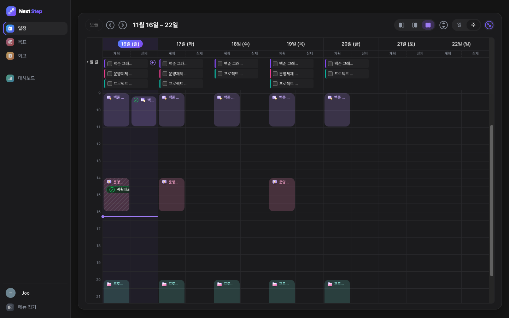
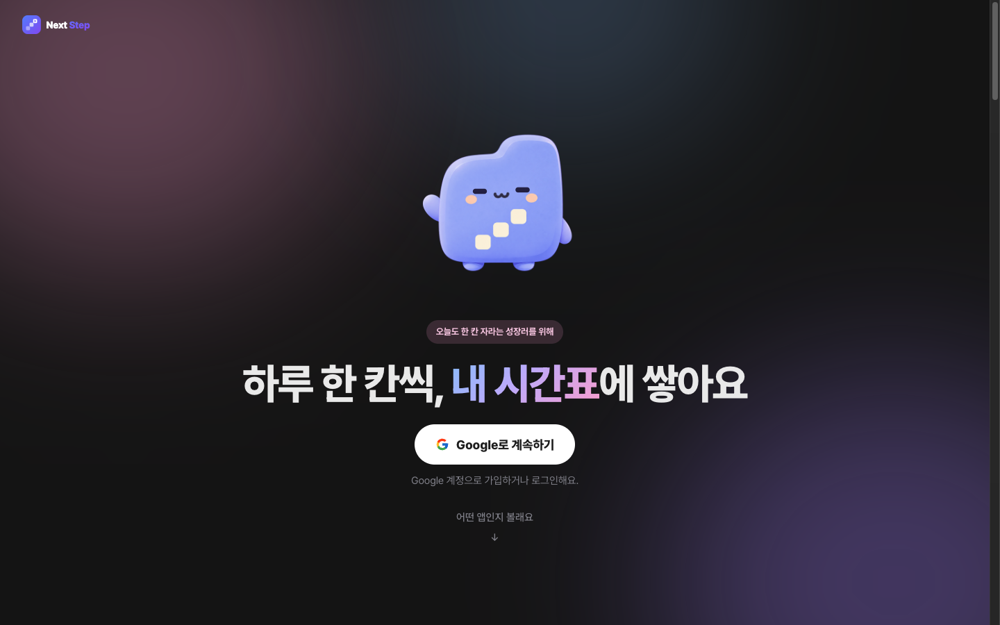
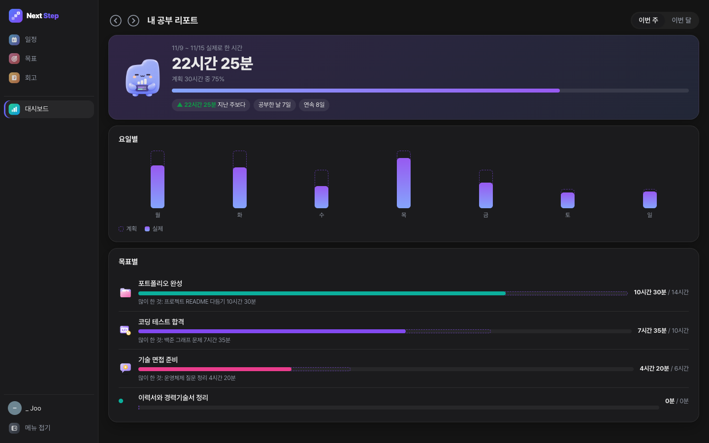
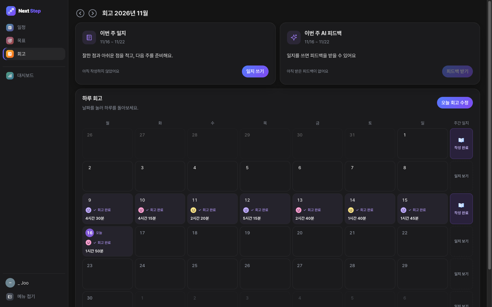
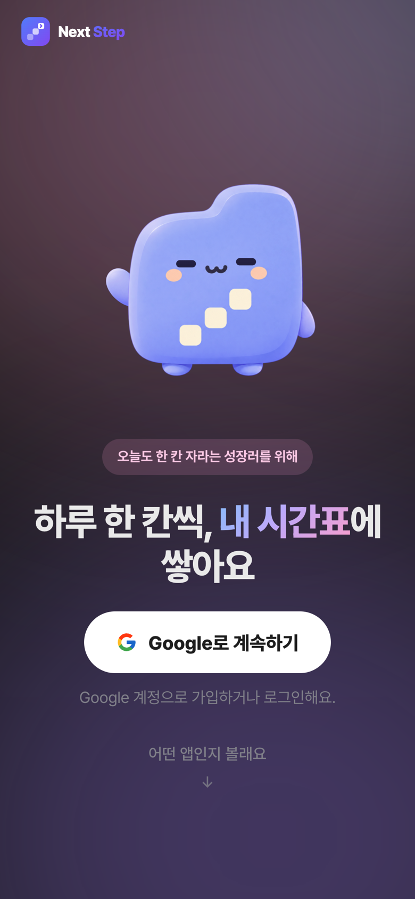
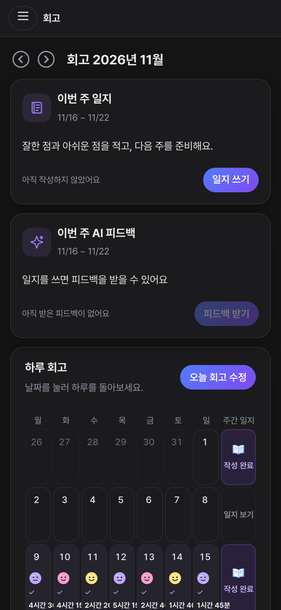
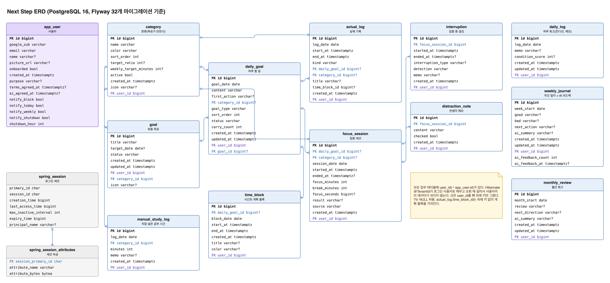

# Next Step: 취업, 이직 준비생의 공부 계획과 회고

[](https://github.com/SANGWOO-JOO/next-step/actions/workflows/ci.yml)

공부 계획은 세워도, 실제로 어디에 시간을 썼는지와 다음 주에 무엇을 바꿀지는 따로 챙기기 어렵습니다. **Next Step은 목표, 주간 시간표, 실제 기록, 회고를 한곳에 묶어 계획과 실제를 나란히 보여 주는 공부 도구입니다.** 이직을 준비하며 직접 쓰려고 시작했고, 기획, 디자인, 백엔드, 프론트엔드, AWS 배포까지 혼자 만들었습니다.

**백엔드에서 다룬 것:** Hibernate `@TenantId`로 사용자별 데이터 분리, PostgreSQL에 저장하는 서버 세션과 CSRF 토큰, 서버가 집계한 숫자만 넘기는 AI 주간 피드백(Claude Haiku 5.5), GitHub Actions OIDC 태그 배포와 자동 롤백.

**운영:** 2026-10-26부터 https://nextstep-plan.work 에서 운영했고, 2026-11-18 비용 문제로 AWS 서버를 내렸습니다. 아래 [화면](#화면)과 [아키텍처](#시스템-아키텍처)는 운영하던 구성 그대로이고, CloudFormation 템플릿과 DB 백업으로 다시 올릴 수 있습니다.

**빠르게 보기:** [핵심 설계 결정](#핵심-설계-결정) / [운영하며 해결한 문제](#운영하며-해결한-문제) / [테스트](#테스트) / [한계와 다음 계획](#한계와-다음-계획) / [로컬 실행](#로컬-실행)

## 무엇을 하나

| 화면 | 하는 일 |
|---|---|
| **목표** | 지금 준비하는 목표를 3개까지 두고, 이번 주에 일정을 얼마나 잡았고 실제로 얼마나 했는지 봅니다 |
| **일정** | 할 일을 시간표에 끌어다 놓아 계획을 잡고, 실제로 한 시간을 같은 표에 나란히 기록합니다 (일, 주 보기) |
| **회고** | 날마다 컨디션과 메모를 남기고, 주간 일지(잘한 점, 아쉬운 점, 바꿀 한 가지)를 씁니다 |
| **AI 주간 피드백** | 일지를 쓰고 그 주 공부 기록이 1시간 이상이면, 그 주 숫자와 일지를 근거로 한 줄 요약, 잘한 점, 해 볼 것을 받습니다 (하루 1번, 한 주 3번까지) |
| **대시보드** | 주, 달 단위로 계획 대비 실제, 요일별, 목표별 시간과 연속 공부일을 봅니다 |

## 핵심 설계 결정

| 결정 | 이유 | 감수한 점 |
|---|---|---|
| **서버 세션 (JWT 아님), Spring Session JDBC** | 토큰을 브라우저 자바스크립트가 만지지 않고, 강제 로그아웃과 탈퇴 시 세션 삭제가 쉽습니다. 재시작과 배포에도 로그인이 유지됩니다 | Redis를 두지 않는 대신 세션 조회와 갱신이 업무 DB에 함께 부하를 줍니다 |
| **CSRF 쿠키 토큰** (`XSRF-TOKEN` → `X-XSRF-TOKEN` 헤더) | 세션 쿠키를 쓰므로 SameSite=Lax에 더해 상태를 바꾸는 요청마다 토큰을 검증합니다 | 프론트의 모든 변경 요청이 헤더를 붙여야 해서 `api/client.ts` 한곳으로 모았습니다 |
| **`@TenantId` 사용자 분리** | 업무 테이블마다 `user_id`를 두고 Hibernate가 저장 때 채우고 조회 때 걸러, 쿼리마다 조건을 빠뜨릴 위험을 없앴습니다 | 세션 읽기와 얽혀 무한 반복이 생겼고, 세션 쪽에 JDBC 트랜잭션 매니저를 따로 두어 풀었습니다 ([기록](docs/troubleshooting/2026-10-25-spring-session-login.md)) |
| **AI에는 해석만 맡기기** | 시간과 비율은 서버가 계산하고 Claude에는 그 숫자와 일지의 해석을 요청합니다. 요약과 잘한 점에 입력에 없는 숫자가 나오면 한 번 다시 요청합니다 | 숫자 문자열만 비교하므로 숫자의 의미까지 검증하지는 않습니다 |
| **AI 전송 범위** | 동의한 사용자만, 목표 이름과 시간, 일지 글만 보내고 계정 이름과 이메일은 빼고 보냅니다. 키가 없으면 그 기능만 꺼집니다 | 사용자가 일지에 직접 적은 개인정보는 함께 갈 수 있습니다 |
| **EC2 한 대 + Docker Compose** (앱과 PostgreSQL) | RDS, ECS보다 고정비가 작고(월 약 $21 예상), CloudFormation으로 다시 만들 수 있습니다 | 서버 장애 때 앱과 DB가 같이 멈추고, 배포 중 잠깐 접속이 끊길 수 있습니다 |
| **Kotlin, Spring Boot 3.5, JPA, Flyway** | 기능 단위 패키지(`goal`, `daily`, `actual`, `review`, `ai` 등), 비즈니스 규칙은 Service에 둡니다. 스키마 변경은 모두 Flyway로 | 테스트는 H2 PostgreSQL 모드라 PostgreSQL 전용 문법은 피해서 씁니다 |
| **React 19, TypeScript, Vite** | 시간표 끌어 놓기, 칠하기 같은 상호작용을 라이브러리 없이 직접 구현 | 화면 동작 자동 테스트는 아직 없습니다 |

## 화면

예시 데이터로 찍었습니다 (PC 1440px, 휴대폰 390px).

| 일정 (주 보기, 계획과 실제) | 지난주 일지와 AI 피드백 |
|:---:|:---:|
|  |  |

<details>
<summary>화면 더 보기 (랜딩, 목표, 대시보드, 회고 달력, 휴대폰)</summary>

| 랜딩 | 목표 (이번 주 계획과 실제) |
|:---:|:---:|
|  |  |
| **대시보드 (한 주 리포트)** | **회고 (달력과 이번 주 일지, AI 피드백)** |
|  |  |

**휴대폰**

| 랜딩 | 일정 | 회고 | 대시보드 |
|:---:|:---:|:---:|:---:|
|  |  |  |  |

</details>

## 시스템 아키텍처


원본: [docs/diagrams/architecture.drawio](docs/diagrams/architecture.drawio) (draw.io에서 열기)
아이콘: AWS Architecture Icons(draw.io 기본 제공), [Simple Icons](https://simpleicons.org)(CC0). 각 로고의 상표는 해당 회사에 있습니다.

- **도메인 하나로 묶기:** CloudFront가 `/`는 S3(React 빌드)로, `/api`, `/oauth2`, `/login`, `/logout`은 EC2로 보냅니다. 프론트와 API가 같은 출처라 CORS 설정이 필요 없고 세션 쿠키도 그대로 쓰입니다. CSRF는 같은 출처와 별개로 토큰으로 검증합니다.
- **서버 한 대:** EC2 t4g.small 한 대에 Docker Compose로 Spring Boot와 PostgreSQL을 둡니다. 매일 03:00 `pg_dump`를 S3에 7일 보관하고, 복구 연습까지 했습니다.
- **비밀값:** 구글 키, Anthropic 키, DB 비밀번호는 SSM Parameter Store에만 둡니다. 코드와 저장소에는 없습니다.
- **배포:** `v*` 태그를 push하면 GitHub Actions가 검사 → GitHub Release → S3 업로드 → SSM 명령으로 EC2 재시작 → 공개 주소 헬스 체크까지 합니다. AWS 권한은 OIDC로 받아 오래 가는 키가 없습니다. EC2에서 새 JAR이 3분 안에 헬스 체크를 통과하지 못하면 직전 JAR로 되돌립니다. 프론트 파일과 DB 마이그레이션은 자동으로 되돌리지 않습니다.
- **비용:** 인프라 기본 비용 월 약 $21 예상 (EC2 $15, 고정 IP $3.65, EBS $1.8, Route 53 $0.5, 2026-10 산정). 도메인과 Anthropic API 사용료는 별도이고, 월 $25 예산 알림을 둡니다.

## ERD



원본: [docs/diagrams/erd.drawio](docs/diagrams/erd.drawio)

- **사용자별 분리:** 모든 업무 테이블에 `user_id`가 있고, Hibernate `@TenantId`가 로그인 사용자로 채우고 조회 때 걸러서 다른 사람 데이터가 섞이지 않습니다.
- **목표 흐름:** `goal`(최종 목표) → `daily_goal`(하루 할 일) → `time_block`(계획) / `actual_log`(실제). 목표마다 같은 이름과 색의 `category`가 1:1로 붙어 시간 집계 단위가 됩니다.
- **세션:** 로그인 세션은 `spring_session`에 저장해 서버를 다시 켜거나 배포해도 로그인이 유지됩니다.
- 스키마 변경은 모두 Flyway 마이그레이션(`V{yyyyMMddHHmm}__설명.sql`)으로 하고, PostgreSQL과 테스트용 H2 양쪽에서 돌게 씁니다.

## 운영하며 해결한 문제

| 문제 | 원인과 해결 |
|---|---|
| [세션 저장소를 바꾼 뒤 로그인 500](docs/troubleshooting/2026-10-25-spring-session-login.md) | 세션 읽기 → JPA → 멀티테넌시 → 세션 읽기 무한 반복. 세션에 순수 JDBC 트랜잭션 매니저를 따로 둠 |
| [CI(UTC)에서만 테스트 3개 실패](docs/troubleshooting/2026-10-25-ci-timezone.md) | 테스트는 `main()`을 거치지 않아 시간대가 늦게 정해짐. 테스트 JVM을 Asia/Seoul로 고정 |
| [첫 배포에서 GitHub OIDC 역할을 받지 못함](docs/troubleshooting/2026-10-26-github-oidc-immutable-sub.md) | GitHub의 새 subject 형식(`owner@id/repo@id`)을 신뢰 정책에 추가. 스택 갱신이 서버 교체로 번질 위험을 발견해 AMI 고정 |
| [운영에서 구글 계정을 고르면 화면이 넘어가지 않음](docs/troubleshooting/2026-10-26-oauth-redirect-origin-host.md) | CloudFront가 넘긴 오리진 호스트로 리다이렉트 주소가 만들어짐. 상대 주소 리다이렉트로 해결 |
| [AI 피드백이 "지난주"를 다른 주로 헷갈림](docs/troubleshooting/2026-10-25-ai-feedback-week-naming.md) | 입력 JSON의 키 이름이 프롬프트처럼 읽힘. 키 이름과 규칙을 고침 |

전체 목록: [docs/troubleshooting](docs/troubleshooting/README.md)

## 테스트

- **백엔드:** H2(PostgreSQL 모드)에서 `@SpringBootTest` 통합 테스트와 MockMvc 컨트롤러 테스트를 돌립니다 (테스트 117개, GitHub Actions에서 main push와 PR마다 실행).
- **주로 검증하는 것:** 다른 사용자 데이터 조회와 수정 차단(`UserIsolationTest`), CSRF 토큰 없는 요청 거절(`CsrfTest`), 계획과 실제 시간 집계, 목표 수 제한, 세션 직렬화, 탈퇴 시 데이터 삭제, AI 동의와 생성 횟수 제한.
- **시간과 외부 호출:** 시각은 `Clock`을 주입해 고정하고, Claude 호출은 가짜 클라이언트(`FakeFeedbackClient`)로 바꿔 실제 API를 부르지 않습니다.
- **프론트:** TypeScript 빌드와 ESLint만 검사합니다. 화면 동작 자동 테스트는 아직 없습니다.

## 한계와 다음 계획

| 진행 상황 | |
|---|---|
| 1단계 개인 도구: 목표, 시간표, 집중 모드, 기록, 회고, 대시보드, 알림 설정 | 완료 |
| 2단계 여러 사용자 서비스: 구글 로그인, 사용자 분리, 시작 설정, 랜딩, 약관, 화면 개편 | 완료 |
| 3단계 AI 주간 피드백 (Claude Haiku 5.5) | 완료 |
| AWS 배포 (CloudFront, EC2, GitHub Actions 자동 배포) | `v0.1.3`까지 운영, 2026-11-18 중지 |
| 구글 OAuth 프로덕션 게시 | 예정 |

- **동시성:** 목표 수와 AI 생성 횟수 제한은 서비스에서 검사합니다. 같은 요청이 동시에 들어올 때도 제한이 지켜지는지는 아직 따로 검증하지 않았습니다. 중복 AI 호출과 시간 기록 충돌을 먼저 점검할 계획입니다.
- **성능:** 테스트 사용자만 쓰는 단계라 부하 테스트로 처리량과 응답 시간을 재지 않았습니다. 대시보드 집계 API의 응답 시간과 쿼리 수를 먼저 재고, 결과에 따라 인덱스나 캐시를 검토하려 합니다.
- **가용성:** 서버 한 대 구성이라 장애 때 서비스가 멈춥니다. 사용자가 늘면 DB를 RDS로, 세션을 Redis로 옮기는 순서를 고려하고 있습니다.

## 저장소 구조

```
backend/    Spring Boot (Kotlin). 기능 단위 패키지와 Flyway 마이그레이션
frontend/   React 화면 (pages, components, api)
deploy/     CloudFormation 템플릿, 운영 Docker Compose, 배포와 백업 스크립트
.github/    CI, Release와 운영 배포 워크플로
docs/       설계, 배포 설계, 트러블 슈팅, 다이어그램, 화면
```

## 로컬 실행

필요: Docker, JDK 21, Node 22. 명령은 모두 저장소 루트에서 시작하고, 백엔드와 프론트는 각각 다른 터미널에서 띄웁니다.

```bash
docker compose up -d                      # PostgreSQL
```

```bash
cd backend && ./gradlew bootRun           # http://localhost:8080
```

```bash
cd frontend && npm ci && npm run dev      # http://localhost:5173 (/api는 8080으로 프록시)
```

- **로그인:** 구글 OAuth 웹 클라이언트를 만들고 승인된 리디렉션 URI에 `http://localhost:5173/login/oauth2/code/google`(프론트 프록시를 거침)을 등록한 뒤, `GOOGLE_CLIENT_ID`, `GOOGLE_CLIENT_SECRET` 환경 변수를 넣습니다. 키가 없어도 서버와 테스트는 돌지만 로그인은 할 수 없습니다.
- **AI 피드백:** `ANTHROPIC_API_KEY`가 있을 때만 켜집니다. 없으면 그 기능만 꺼집니다.
- **검사:** `cd backend && ./gradlew test`, `cd frontend && npm run build && npm run lint`

## 문서

| 문서 | 내용 |
|---|---|
| [docs/design.md](docs/design.md) | 전체 기획과 설계: 화면, 데이터 모델, AI, 단계별 결정과 이유 |
| [docs/deploy.md](docs/deploy.md) | 배포 설계: 구조, 비용, 인증과 보안, CI/CD, 모니터링, 백업, 롤백 |
| [docs/troubleshooting](docs/troubleshooting/README.md) | 문제 해결 기록 (증상 → 원인 → 해결 → 검증 → 배운 점) |
| [docs/diagrams](docs/diagrams) | 아키텍처와 ERD 원본 (draw.io) |
| [CLAUDE.md](CLAUDE.md), [AGENTS.md](AGENTS.md) | AI 코딩 도구 작업 규칙 |

## 라이선스

[MIT](LICENSE)
