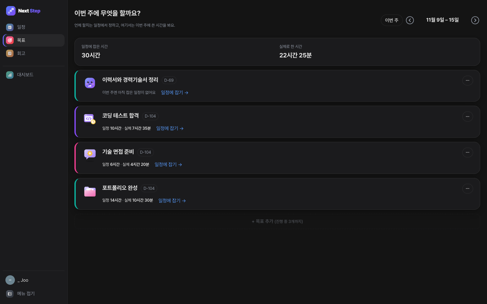
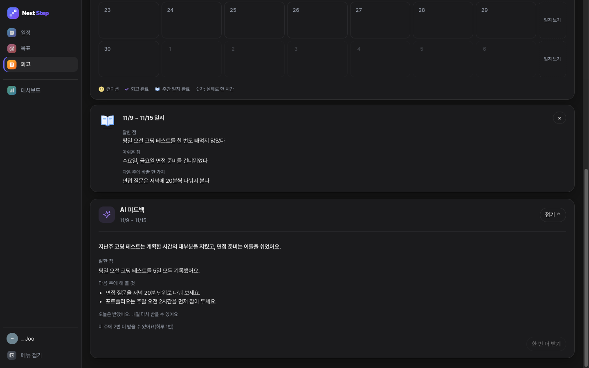
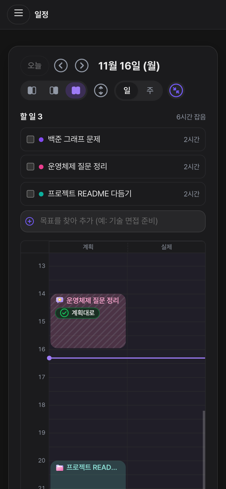
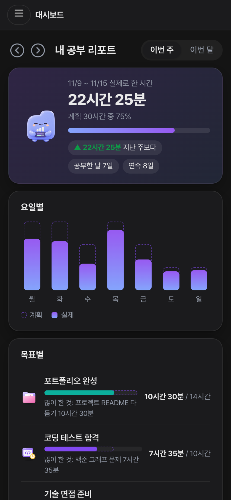
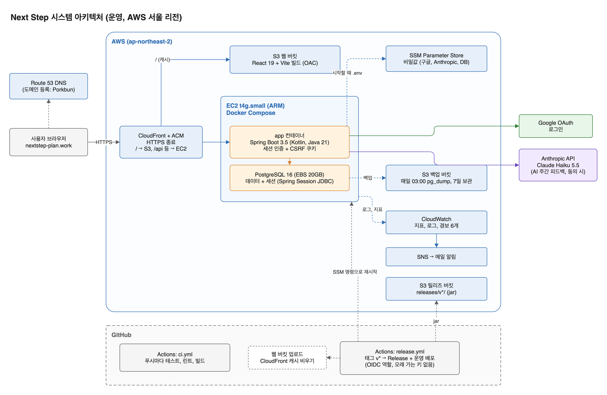

# Next Step: 취업, 이직 준비생의 공부 계획과 회고

[](https://github.com/SANGWOO-JOO/next-step/actions/workflows/ci.yml)

> A study planner for job seekers and career changers: set goals, plan your week, record what you actually did, and review it with AI feedback.

**목표를 정하고, 시간표에 칠하고, 실제로 한 시간을 기록하고, 한 주를 돌아보는 공부 도구.** 계획과 실제를 나란히 보여 주고, 주간 일지를 쓰면 그 주 기록을 근거로 Claude가 짧은 피드백을 줍니다.
기획, 디자인, 백엔드, 프론트엔드, AWS 배포까지 혼자 만든 사이드 프로젝트입니다.

**운영 주소: https://nextstep-plan.work** (구글 로그인. 지금은 테스트 사용자만 가입할 수 있어요)

| 진행 상황 | |
|---|---|
| 1단계 개인 도구: 목표, 시간표, 집중 모드, 기록, 회고, 대시보드, 알림 설정 | 완료 |
| 2단계 여러 사용자 서비스: 구글 로그인, 사용자 분리, 시작 설정, 랜딩, 약관, 화면 개편 | 완료 |
| 3단계 AI 주간 피드백 (Claude Haiku 5.5) | 완료 |
| AWS 배포 (CloudFront, EC2, GitHub Actions 자동 배포) | 운영 중, `v0.1.3` |
| 구글 OAuth 프로덕션 게시 | 예정 |

## 무엇을 하나

| 화면 | 하는 일 |
|---|---|
| **목표** | 지금 준비하는 목표를 3개까지 두고, 이번 주에 일정을 얼마나 잡았고 실제로 얼마나 했는지 봅니다 |
| **일정** | 할 일을 시간표에 끌어다 놓아 계획을 잡고, 실제로 한 시간을 같은 표에 나란히 기록합니다 (일, 주 보기) |
| **회고** | 날마다 컨디션과 메모를 남기고, 주간 일지(잘한 점, 아쉬운 점, 바꿀 한 가지)를 씁니다 |
| **AI 주간 피드백** | 일지를 쓴 주에 기록이 1시간 넘게 쌓이면, 그 주 숫자와 일지를 근거로 한 줄 요약, 잘한 점, 해 볼 것을 받습니다 |
| **대시보드** | 주, 달 단위로 계획 대비 실제, 요일별, 목표별 시간과 연속 공부일을 봅니다 |

- **AI는 숫자를 계산하지 않습니다.** 시간과 비율은 서버가 계산하고, Claude는 받은 숫자와 일지 안에서만 해석합니다. 받은 데이터에 없는 숫자가 나오면 한 번 다시 만듭니다.
- **AI에는 동의한 사람만, 계정 정보 없이 보냅니다.** 목표 이름, 시간, 일지 글만 보내고 이름과 이메일은 보내지 않습니다. 하루 1번, 한 주 3번까지.
- 처음 들어오면 목적(취업 준비생, 이직 준비 중)과 첫 목표를 고르고, 이번 주 공부할 시간을 칠해 바로 시작합니다.

## 화면

예시 데이터로 찍었습니다 (PC 1440px, 휴대폰 390px).

| 랜딩 | 일정 (주 보기, 계획과 실제) |
|:---:|:---:|
|  |  |
| **목표 (이번 주 계획과 실제)** | **대시보드 (한 주 리포트)** |
|  |  |
| **회고 (달력과 이번 주 일지, AI 피드백)** | **지난주 일지와 AI 피드백** |
|  |  |

**휴대폰**

| 랜딩 | 일정 | 회고 | 대시보드 |
|:---:|:---:|:---:|:---:|
|  |  |  |  |

## 시스템 아키텍처



원본: [docs/diagrams/architecture.drawio](docs/diagrams/architecture.drawio) (draw.io에서 열기)

- **도메인 하나로 묶기:** CloudFront가 `/`는 S3(React 빌드)로, `/api`, `/oauth2`, `/login`, `/logout`은 EC2로 보냅니다. 같은 출처라 세션 쿠키와 CSRF, CORS 문제가 없습니다.
- **서버 한 대:** EC2 t4g.small 한 대에 Docker Compose로 Spring Boot와 PostgreSQL을 둡니다. 매일 03:00 `pg_dump`를 S3에 7일 보관하고, 복구 연습까지 했습니다.
- **비밀값:** 구글 키, Anthropic 키, DB 비밀번호는 SSM Parameter Store에만 둡니다. 코드와 저장소에는 없습니다.
- **배포:** `v*` 태그를 push하면 GitHub Actions가 검사 → GitHub Release → S3 업로드 → SSM 명령으로 EC2 재시작 → 공개 주소 헬스 체크까지 합니다. AWS 권한은 OIDC로 받아 오래 가는 키가 없습니다. 헬스 체크가 3분 안에 UP이 안 되면 직전 버전으로 스스로 되돌립니다.
- **비용:** 월 약 $21 (EC2 $15, 고정 IP $3.65, EBS $1.8, Route 53 $0.5). 월 $25 예산 알림을 둡니다.

## ERD


원본: [docs/diagrams/erd.drawio](docs/diagrams/erd.drawio)

- **사용자별 분리:** 모든 업무 테이블에 `user_id`가 있고, Hibernate `@TenantId`가 로그인 사용자로 채우고 조회 때 걸러서 다른 사람 데이터가 섞이지 않습니다.
- **목표 흐름:** `goal`(최종 목표) → `daily_goal`(하루 할 일) → `time_block`(계획) / `actual_log`(실제). 목표마다 같은 이름과 색의 `category`가 1:1로 붙어 시간 집계 단위가 됩니다.
- **세션:** 로그인 세션은 `spring_session`에 저장해 서버를 다시 켜거나 배포해도 로그인이 유지됩니다.
- 스키마 변경은 모두 Flyway 마이그레이션(`V{yyyyMMddHHmm}__설명.sql`)으로 하고, PostgreSQL과 테스트용 H2 양쪽에서 돌게 씁니다.

## 기술 선택

| 영역 | 선택 | 이유 |
|---|---|---|
| 백엔드 | Kotlin, Spring Boot 3.5, Java 21, JPA, Flyway | 기능 단위 패키지(`goal`, `daily`, `actual`, `review`, `ai` 등), 비즈니스 규칙은 Service에 두고 단위 테스트 |
| 인증 | 구글 로그인 + 서버 세션 (JWT 아님) | 토큰을 브라우저 자바스크립트가 만지지 않고, 강제 로그아웃과 탈퇴 시 세션 삭제가 쉽습니다 |
| 세션 저장 | Spring Session JDBC (PostgreSQL) | 재시작, 배포에도 로그인 유지. Redis 없이 서버 한 대로 충분 |
| CSRF | 쿠키 방식 (`XSRF-TOKEN` → `X-XSRF-TOKEN` 헤더) | SameSite=Lax로 막지 못하는 경우를 한 겹 더 막습니다 |
| AI | Claude Haiku 5.5, 공식 Anthropic Java SDK, JSON 고정 형식 출력 | 짧은 요약형 작업이라 작은 모델로 충분하고 비용이 낮습니다 |
| 프론트 | React 19, TypeScript, Vite | 시간표 끌어 놓기, 칠하기 같은 상호작용을 직접 구현 |
| 인프라 | CloudFront + S3 + EC2 한 대, CloudFormation | RDS, ECS, EKS보다 고정비가 작고, 템플릿으로 다시 만들 수 있습니다 |
| CI/CD | GitHub Actions (OIDC), 태그 기반 Release | 키 없이 배포하고, 실패하면 자동으로 이전 버전으로 |

## 운영하며 해결한 문제

| 문제 | 원인과 해결 |
|---|---|
| [세션 저장소를 바꾼 뒤 로그인 500](docs/troubleshooting/2026-10-25-spring-session-login.md) | 세션 읽기 → JPA → 멀티테넌시 → 세션 읽기 무한 반복. 세션에 순수 JDBC 트랜잭션 매니저를 따로 둠 |
| [CI(UTC)에서만 테스트 3개 실패](docs/troubleshooting/2026-10-25-ci-timezone.md) | 테스트는 `main()`을 거치지 않아 시간대가 늦게 정해짐. 테스트 JVM을 Asia/Seoul로 고정 |
| [첫 배포에서 GitHub OIDC 역할을 받지 못함](docs/troubleshooting/2026-10-26-github-oidc-immutable-sub.md) | GitHub의 새 subject 형식(`owner@id/repo@id`)을 신뢰 정책에 추가. 스택 갱신이 서버 교체로 번질 위험을 발견해 AMI 고정 |
| [운영에서 구글 계정을 고르면 화면이 넘어가지 않음](docs/troubleshooting/2026-10-26-oauth-redirect-origin-host.md) | CloudFront가 넘긴 오리진 호스트로 리다이렉트 주소가 만들어짐. 상대 주소 리다이렉트로 해결 |
| [AI 피드백이 "지난주"를 다른 주로 헷갈림](docs/troubleshooting/2026-10-25-ai-feedback-week-naming.md) | 입력 JSON의 키 이름이 프롬프트처럼 읽힘. 키 이름과 규칙을 고침 |

전체 목록: [docs/troubleshooting](docs/troubleshooting/README.md)

## 저장소 구조

```
backend/    Spring Boot (Kotlin). 기능 단위 패키지와 Flyway 마이그레이션
frontend/   React 화면 (pages, components, api)
deploy/     CloudFormation 템플릿, 운영 Docker Compose, 배포와 백업 스크립트
.github/    CI, Release와 운영 배포 워크플로
docs/       설계, 배포 설계, 트러블 슈팅, 다이어그램, 화면
```

## 로컬 실행

필요: Docker, JDK 21, Node 22

```bash
docker compose up -d                      # PostgreSQL
cd backend && ./gradlew bootRun           # http://localhost:8080
cd frontend && npm install && npm run dev # http://localhost:5173 (/api는 8080으로 프록시)
```

- 구글 로그인은 `GOOGLE_CLIENT_ID`, `GOOGLE_CLIENT_SECRET` 환경 변수가 필요합니다. AI 피드백은 `ANTHROPIC_API_KEY`가 있을 때만 켜집니다(없으면 그 기능만 꺼짐).
- 테스트: `cd backend && ./gradlew test` (H2, 테스트 117개), `cd frontend && npm run build && npm run lint`

## 문서

| 문서 | 내용 |
|---|---|
| [docs/design.md](docs/design.md) | 전체 기획과 설계: 화면, 데이터 모델, AI, 단계별 결정과 이유 |
| [docs/deploy.md](docs/deploy.md) | 배포 설계: 구조, 비용, 인증과 보안, CI/CD, 모니터링, 백업, 롤백 |
| [docs/troubleshooting](docs/troubleshooting/README.md) | 문제 해결 기록 (증상 → 원인 → 해결 → 검증 → 배운 점) |
| [docs/diagrams](docs/diagrams) | 아키텍처와 ERD 원본 (draw.io) |
| [CLAUDE.md](CLAUDE.md), [AGENTS.md](AGENTS.md) | AI 코딩 도구 작업 규칙 |

## 라이선스

[MIT](LICENSE)
